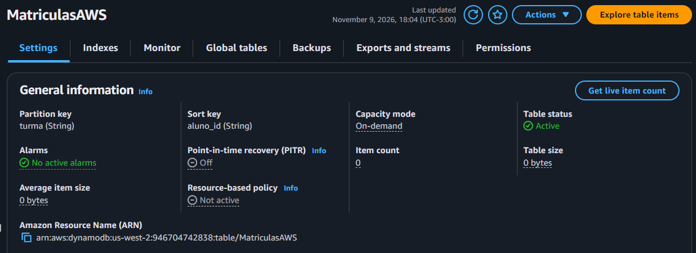
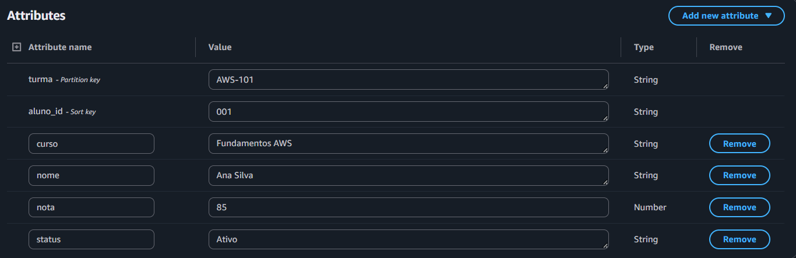
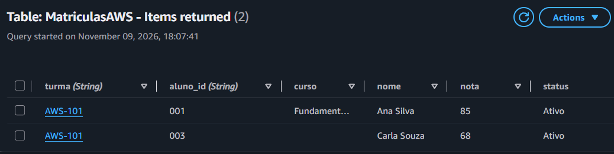
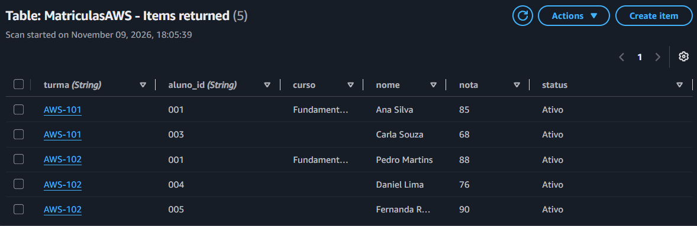

# Lab Extra 01 - Amazon DynamoDB

## Visão geral

Laboratório prático de criação e gerenciamento de uma tabela no **Amazon DynamoDB**, serviço de banco de dados NoSQL gerenciado da AWS.

**Atividades:** criação de tabela, inserção de registros, consultas, atualização e exclusão de dados.

## 1. Criação da tabela

Tabela `MatriculasAWS`, configurada com chave primária composta:

| Configuração | Valor |
|---|---|
| Partition key | `turma` (String) |
| Sort key | `aluno_id` (String) |
| Classe | DynamoDB Standard |
| Capacidade | On-demand |

A combinação de `turma` e `aluno_id` identifica cada registro de forma exclusiva.

## 2. Inserção de registros

Foram cadastrados estudantes com atributos de identificação, curso, situação acadêmica e nota. O identificador `aluno_id` foi definido como String para preservar zeros à esquerda.

## 3. Consultas

Foram utilizadas duas operações para recuperar os dados:

- **Query:** consulta registros a partir da chave de partição, permitindo buscar estudantes por turma.
- **Scan:** percorre os itens da tabela, permitindo recuperar registros sem especificar a chave de partição.

## 4. Operações CRUD

Durante o laboratório, foram praticadas as operações fundamentais de manipulação de dados:

| Operação | Atividade |
|---|---|
| Create | Inserção de estudantes |
| Read | Consultas com Query e Scan |
| Update | Alteração da situação acadêmica e das notas |
| Delete | Exclusão de registros |

Também foi proposto um desafio complementar de inserção de um novo estudante e consulta dos registros da turma.

## 5. Aprendizados

- Criação e configuração de tabelas no Amazon DynamoDB.
- Diferenças entre Partition key e Sort key.
- Utilização de Query e Scan.
- Manipulação de dados por meio das operações CRUD.
- Compreensão do modelo de capacidade On-demand.

---

**Material complementar:** a página do projeto apresenta um resumo visual e 8 flashcards interativos para revisão dos conceitos estudados.

[**Acessar página do laboratório**](https://brunogacarvalho.github.io/lab-extra-01-amazon-dynamodb/)

*Laboratório complementar - Escola da Nuvem | Computação em Nuvem AWS*
